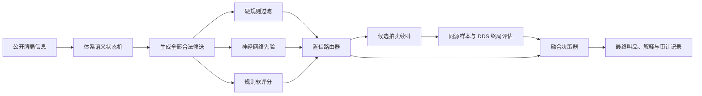

# BridgeLab v0.4 详细开发方案（待拍板）

状态：仅完成方案设计，尚未创建或修改 v0.4 代码。

## 一、版本目标与边界

v0.4 定义为“可解释的神经网络叫牌融合版本”：规则守住合法性、体系语义和低级错误底线；神经网络改善复杂局面的候选排序；公开信息采样与 DDS 只评估已经推演到最终定约的结果。

生产范围先集中于“SAYC＋2/1进局逼叫＋RKCB 1430”。该默认卡采用 SAYC 的自然开叫与竞争方法、未 Pass 且无干扰的二盖一进局逼叫、5–12 HCP 半逼叫 1NT 及 RKCB 1430；精确制继续使用 v0.3 规则或暂时隐藏为研究功能。打牌沿用 v0.3 的安全规则、公开信息采样和 DDS，不在同一版本中整体替换打牌策略，只允许通过回归验证的采样质量改进。

v0.4 不直接让模型接管叫牌，也不允许模型读取真实隐藏手牌。DDS 不能直接给单个叫品评分，因为它只理解完整四家牌和最终定约；必须先在同一批公开信息样本上把各候选叫品推演到拍卖结束，再比较最终定约的得分分布。

## 二、总体架构

每个候选叫品保存以下信息：合法性、体系含义、硬规则过滤原因、模型原始概率、校准后概率、规则评分、样本数量、拍卖续叫结果、DDS 得分分布、方差、最终排序和采用理由。模型加载失败、超时、输出异常或体系冲突时，决策必须确定性回退到规则引擎。

## 三、规则职责

### 硬规则：拥有否决权

- 叫品必须合法；加倍、再加倍和竞叫阶数必须符合当前拍卖。
- 未解除一轮逼叫或进局逼叫时不能 Pass。
- 人工叫品不能被当作自然花色，也不能停在人工定约上。
- 开叫、应叫、再叫、争叫、扣叫、阻击、加倍和 RKCB 回答不能违反已声明范围。
- 已知明确达到成局的黄金牌例不得停在部分定约。
- RKCB、将牌 Q 问叫、5NT 旁门 K 问叫及其回答必须保持成套语义。
- 实战决策输入只能包含本家牌、公开明手、叫牌、已出牌、局况和由此推导出的约束。
- 所有异常必须回退到可完成整副牌的规则路径。

### 软规则：参与排序

- 五张高花、较长套、无将牌型与止张质量。
- 邀请、成局和满贯的点力边界。
- 八张以上配合、短套调整点、控制张和将牌质量。
- 局况、位置、竞争强度、牺牲风险和描述性价值。
- 体系内的优先顺序与后续可叫性。

规则评分不替代语义状态机。每个叫品的“自然／人工、逼叫轮次、点力范围、套长范围、是否建立配合、谁是队长、当前问答阶段”都应成为显式状态，避免继续依赖零散历史模式匹配。

## 四、模型路线

第一候选为 [BRL](https://github.com/harukaki/brl) 的监督学习叫牌模型，作为模型先验接入。该项目采用 Apache-2.0 许可，但其叫牌风格更接近 WBridge5，不能直接称为 SAYC 引擎。v0.4 需要复现其输入编码和 38 个叫品输出，再由 BridgeLab 的体系语义和硬规则约束。

[Nickel Bridge](https://github.com/brannondorsey/nickel-bridge) 可作为浏览器 TypeScript 推理与编码复现的实现参考，但不会直接复制来源和许可不清楚的代码。BEN 暂不作为主路线，因为 [BEN](https://github.com/lorserker/ben) 的 Python／TensorFlow 服务和 GPL-3.0 许可会改变当前纯浏览器离线架构及发布边界。

模型输出只能称为“偏好概率”。在完成温度缩放、可靠性图和保留集校准前，不把最大 softmax 值称为置信度。

## 五、四个实施阶段

### 第一阶段：基线冻结与影子模型

交付内容：

- 用户拍板后才从最终 v0.3 复制出独立的 `versions/v0.4`，保留 v0.3 原文件、测试证据和发布包。
- 记录 v0.3 源码、测试语料、固定牌例和发布包的 SHA-256，建立可重复比较基线。
- 转换并本地保存 BRL 权重，记录上游提交、许可证、转换脚本和文件哈希。
- 在 Web Worker 中实现浏览器本地推理；模型加载不阻塞规则模式。
- 逐位复现输入编码、合法叫品映射和输出顺序，并用固定样例比较原模型和 TypeScript 的 logits、排序和 Top-K。
- 影子模式只记录建议，不改变实际叫牌。
- 模型大文件使用版本化运行时缓存；首次安装完成后可离线运行，缓存损坏时自动回退规则模式。

阶段门槛：编码逐位一致；合法叫品映射 100% 一致；固定样例 Top-K 一致；加载失败不影响完成整副牌；离线重启可用。

停止条件：无法取得可审计的合法权重与许可；编码无法稳定复现；模型导致首次加载或离线缓存不可接受；桌面中端设备推理延迟超过预算且无法通过量化或 Worker 化解决。

### 第二阶段：体系语义与受约束融合

交付内容：

- 建立统一拍卖语义状态机，覆盖自然 SAYC、争叫、扣叫、阻击、加倍、Stayman、转移、强 2♣、第四花色、新低花、RKCB、Q 问叫和 5NT 旁门 K 问叫。
- 建立统一候选对象和机器可读的硬规则违规原因。
- 实现规则、模型、融合、研究四种内部运行配置；产品默认只展示规则和融合模式。
- 建立置信路由：高一致性直接融合；轻微分歧进入有限评估；低置信或体系冲突回退规则；全部异常进入语义安全兜底。
- 每次决策保存完整候选排名和版本信息，支持从异常牌例反查具体责任层。

阶段门槛：叫牌合法率 100%；逼叫误 Pass 为 0；停在人工定约为 0；体系硬约束违反为 0；模型输入在未公开隐藏牌任意置换后完全不变。

停止条件：融合层无法明确指出过滤原因；同一输入不能确定性复现；隐藏牌置换改变模型输入或决策；规则回退不能独立完成整副牌。

### 第三阶段：成局、满贯与 DDS 价值校验

交付内容：

- 建立成局、邀请和满贯专项决策层，覆盖无将定量判断、花色配合调整点、控制叫、RKCB 1430、将牌 Q 问叫、5NT 旁门 K 问叫及最终签约。
- 对需要高价值校验的候选，在同一批满足公开信息约束的样本上续叫到最终定约。
- 只对最终定约调用 DDS，按局况计算原始分或 IMP 价值；候选共用同一批样本，降低比较噪声。
- 设置固定时间、样本和方差预算；样本不足、拍卖续叫不稳定或 DDS 超时即回退规则／模型融合结果。
- 满贯决策同时检查关键张、控制、将牌质量和失墩，不使用单一组合 HCP 阈值直接决定。

阶段门槛：固定成局牌例的明确漏叫为 0；固定满贯牌例中“缺关键张仍冒叫”和“关键张齐全却无合理探索”的严重错误为 0；DDS 评估不得读取当前真实隐藏手牌；关闭 DDS 后仍能合法完成叫牌。

停止条件：候选续叫不能稳定到终局；在线评估超过交互延迟预算；DDS 排名对样本扰动过度敏感且无法通过增加样本或风险惩罚控制。

### 第四阶段：产品化、评测与发布

交付内容：

- 规则模式：只使用体系规则。
- 融合模式：规则＋模型，作为推荐默认。
- 研究视图：展示模型偏好、过滤原因、规则评分、样本分布和 DDS 终局价值。
- 用户解释示例：“建议 3NT。开叫人已公开 18～19 HCP，联手最低 26 点；Pass 被进局底线规则过滤。”
- 建立固定黄金牌例、随机重复牌和历史问题牌例三层评测集。
- 比较 v0.3 规则、纯模型、融合、关闭 DDS、关闭软规则五组策略；使用同牌同局况配对比较，并报告均值、置信区间和失败类型。
- 发布包保留模型哈希、规则版本、体系卡版本、评测摘要、第三方许可及完全离线回退说明。

阶段门槛：所有硬性指标通过；融合策略在预先冻结的重复牌集合中优于或不劣于 v0.3，且 95% 置信区间不显示明确退步；生产构建、离线缓存和整套浏览器流程通过。

停止条件：融合只改善少数示例却使固定集合显著退步；评测无法复现；模型故障会阻断牌局；发布包不能说明权重来源和许可证。

## 六、硬性验收指标

| 指标 | 要求 |
| --- | ---: |
| 叫牌合法率 | 100% |
| 未解除逼叫时误 Pass | 0 |
| 停在人工定约 | 0 |
| 体系硬约束违反 | 0 |
| 冻结黄金集中的明确成局漏叫 | 0 |
| 冻结黄金集中的严重满贯错误 | 0 |
| 隐藏手牌置换后模型输入与决策变化 | 0 |
| 模型缺失／损坏／超时后的规则回退失败 | 0 |
| 离线安装后无法完成整副牌 | 0 |
| v0.3 打牌安全层回归 | 0 |

“明确成局”和“严重满贯错误”必须在开发前冻结成可判定的牌例定义，不能事后按结果调整。25、32～33、36～37 HCP 只是常见参考区间，不作为无条件硬规则。

## 七、评测设计

- 单元层：编码、叫品映射、语义状态、硬规则、异常回退和模型哈希。
- 黄金牌例层：已有 v0.3 问题牌、SAYC 标准序列、竞争叫、人工叫、进局和满贯边界。
- 变形层：对未公开的 39 张牌作置换，断言观察、模型输入、候选和决策不变。
- 重复牌层：至少 2,000 副固定牌，同一副牌交换方位和局况，按配对原始分／IMP 比较。
- 消融层：规则、纯模型、融合、无 DDS、无软规则。
- 性能层：记录模型加载、单次推理、候选续叫、DDS 评估的 P50／P95、缓存大小和内存峰值。
- 产品层：模型首次加载、已缓存离线、缓存损坏、Worker 崩溃、刷新恢复和旧存档迁移。

## 八、拍板项

请一次确认以下四项后再开始 v0.4：

1. 生产体系以“SAYC＋2/1进局逼叫＋RKCB 1430”为唯一正式验收对象；精确制暂缓。
2. BRL 只作为先验模型，任何时候都受硬规则约束。
3. DDS 只有在候选能可靠续叫到最终定约后才进入在线价值评分；此前仅做离线评测。
4. v0.4 保持 v0.3 打牌主策略不变，只接受独立验证且不退步的采样改良。

拍板后再创建 `versions/v0.4`，按阶段逐一交付；任一阶段未过门槛，不进入下一阶段。
